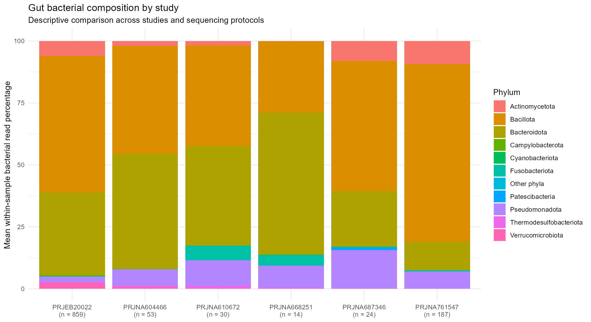

# 16S Human Gut Microbiome Analysis Using DADA2

**An academic team project analyzing public 16S rRNA amplicon sequencing datasets in R.**

This repository contains a reusable R workflow, documented study-selection decisions, verified **archived** outputs, and a descriptive comparison of bacterial phylum composition across six independent human gut microbiome studies.

**Project team:** Vansh Shah, Bhavya, and Krupa. Study allocation is documented in [`studies.tsv`](studies.tsv). This is a **team project**, not a claim that any one member independently produced every dataset or line of code.



## Research aim

Apply a common DADA2 analysis framework to publicly archived amplicon sequencing data, while recording study-specific primer handling, sequence layout, quality settings, and limitations. Summarize within-sample bacterial phylum percentages and compare them descriptively across the six studies.

**This is not a pooled case-control analysis or a clinical prediction study.** Differences between cohorts, sequencing regions, library preparation, and data preprocessing limit interpretation. Read counts refer to **archived sequencing runs**, which should not automatically be treated as unique human participants.

## Six studies and archived outputs

| Public archive study | Team allocation | Amplicon region | Selected runs with saved outputs | Median reads retained after chimera removal* |
|---|---|---|---:|---:|
| [PRJNA687346](https://www.ncbi.nlm.nih.gov/bioproject/PRJNA687346) | Vansh | V3–V4 | 24 | 94.5% |
| [PRJNA761547](https://www.ncbi.nlm.nih.gov/bioproject/PRJNA761547) | Vansh | V3–V4 | 187 | 51.5% |
| [PRJNA604466](https://www.ncbi.nlm.nih.gov/bioproject/PRJNA604466) | Bhavya | V3–V4 | 53 | 81.1% |
| [PRJNA610672](https://www.ncbi.nlm.nih.gov/bioproject/PRJNA610672) | Bhavya | V3–V4 | 30 | 96.9% |
| [PRJEB20022](https://www.ebi.ac.uk/ena/browser/view/PRJEB20022) | Krupa | V4 | 859 | 98.9% |
| [PRJNA668251](https://www.ncbi.nlm.nih.gov/bioproject/PRJNA668251) | Krupa | V3–V4 | 14 | 80.8% |
| **Total** | **Three team members** | | **1,167** | |

*Median per-run percentage of non-chimeric reads relative to the reads/pairs entering DADA2, after primer trimming when used. These figures come from the archived team summary, not a new run performed for this GitHub export.*

The archive includes differing read layouts and important exceptions: the `PRJNA761547` analysis used `noqualErrfun` because archived quality scores had limited variation; `PRJEB20022` used forward reads for 859 selected subject runs after paired-read merging failed. See [`study_audit.md`](study_audit.md) for details and caveats.

## Workflow

1. Inventory public ENA/NCBI runs and filter eligible 16S amplicon data.
2. Inspect read layout, primer presence, quality profiles, and study-specific processing requirements.
3. Retrieve public FASTQ sequences from ENA and verify source checksums when performing a fresh run.
4. Trim primers with Cutadapt where required and apply DADA2 quality filtering.
5. Infer ASVs and remove chimeras, including paired-read merging where the archive supports it.
6. Assign taxonomy against the SILVA 138.2 training reference.
7. Produce per-study ASV tables, taxonomy objects, read tracking, and within-sample bacterial phylum percentages.
8. Combine per-study summaries into a descriptive figure and report.

The R implementation is in [`workflow.R`](workflow.R). The plot/report generator is [`make_final_report.R`](make_final_report.R).

## Repository contents

```text
.
├── README.md                   # Research summary and instructions
├── studies.tsv                # Six-study settings and team allocation
├── runs.tsv                   # ENA/NCBI run inventory and download checksums
├── workflow.R                 # R workflow for inventory, preview, trial, pilot, full
├── fix_cutadapt_windows.R     # Windows WSL Cutadapt helper
├── make_final_report.R        # Rebuild combined plot/report from saved outputs
├── START_HERE.md              # Original team working guide, annotated for public export
├── study_audit.md             # Dataset selections, exceptions, source papers
├── VALIDATION.md              # Checks reported in the original team archive
├── verified_full_results.tsv  # Original MD5 fingerprints for per-study outputs
├── example_results/           # Small illustrative result tables
└── results/
    ├── study_inventory.tsv
    ├── combined/               # Summary tables, plot, original team reports
    └── full/<study_id>/        # ASV/taxonomy RDS and per-study processed tables
```

### How to view the saved results

You can inspect these files without re-running DADA2:

- [`results/combined/study_phylum_composition.png`](results/combined/study_phylum_composition.png): six-study composition plot
- [`results/combined/study_read_summary.tsv`](results/combined/study_read_summary.tsv): run counts, region, and median retention
- [`results/combined/study_mean_phylum_percent.tsv`](results/combined/study_mean_phylum_percent.tsv): study-level mean percentages
- [`results/combined/sample_phylum_percent.tsv`](results/combined/sample_phylum_percent.tsv): individual archived run/sample percentages
- [`results/combined/Gut_Microbiome_Results_Handout.pdf`](results/combined/Gut_Microbiome_Results_Handout.pdf): original team handout
- [`results/combined/six_study_results_report.pdf`](results/combined/six_study_results_report.pdf): original team results report

Run the inventory from RStudio (from the repository root):

```r
source("workflow.R")
run_team(mode = "inventory")
```

To regenerate combined graphics **from saved outputs** (needs `ggplot2`):

```r
source("make_final_report.R")
```

### Re-running analyses on public sequencing data

The original team environment reported **R 4.5.2, Bioconductor 3.22, DADA2 1.38.0, ggplot2, and Cutadapt 4.7** (for studies requiring primer trimming). See [`START_HERE.md`](START_HERE.md) for installation notes.

```r
source("workflow.R")
run_team("Vansh", "preview")    # Download and inspect up to 3 candidate runs per selected study
run_team("Vansh", "trial")      # Reprocess a small trial subset; requires software and public downloads
```

The original six-study run involved approximately 4.5 GB of compressed input FASTQ files plus intermediate files. Fresh runs require internet access, sufficient storage, the same software/reference versions, and validated environment configuration. **We did not re-run the full workflow while packaging this GitHub version.**

**Important:** The original team ZIP contained three trimmed pilot FASTQ files. These are deliberately **not** included in this public-ready export. Therefore `run_team(mode = "pilot")` will not work unless those specific pilot inputs are restored locally from an authorized source. The regular `preview`, `trial`, and `full` paths are designed to retrieve public ENA data.

## Verification and scientific limitations

- The supplied team archive recorded full outputs for all six study selections. All **42 per-study files** listed in `verified_full_results.tsv` matched their recorded MD5 hashes during preparation of this repository.
- The team's recorded validation activities are described in [`VALIDATION.md`](VALIDATION.md); the report reflects the original team testing and does **not** mean we independently executed every analysis in a new environment.
- The `PRJEB20022` archive includes control runs that were not part of the selected 859-run analysis.
- Sequence composition is descriptive; there are no claims here of disease biomarkers, statistically significant cohort differences, or causal relationships.
- The `Six_Selected_Papers.zip` literature bundle and compressed sequencing reads are intentionally **not** included. The research papers and public archive identifiers are linked in [`study_audit.md`](study_audit.md).

## Team attribution and reuse

This project and its archived results were supplied as a three-person team submission. Individual dataset allocations appear in [`studies.tsv`](studies.tsv). Before making the repository public, confirm that all contributors agree on attribution and on publication of the shared scripts and team-generated outputs. No open-source license is assigned here pending that agreement. Third-party papers, taxonomy databases, and public sequence datasets remain subject to their respective terms.
